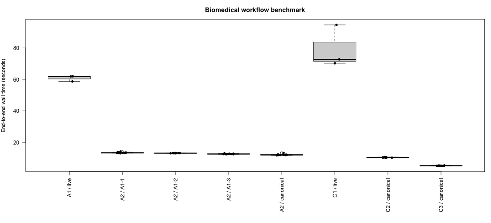

# GSE236581 v0.3 real-data experiment

Frozen plan: **0.3.0**, updated **2026-10-28T21:51:38Z**. Source revision: `03ac9d41f99f5280084b0b1f9b8ae2f8173653be`. Supplementary capture replay conditions are frozen separately under **0.3.1** in `capture-1/manifest.json` and `capture-3/manifest.json`. Both real arms explicitly select **GPT 6.1 Sol (`gpt-6.1-sol`)**, Codex CLI **codex-cli 0.165.0**.

## Data and task

The public [GSE236581 cohort](https://www.ncbi.nlm.nih.gov/geo/query/acc.cgi?acc=GSE236581) supplies real single-cell counts. The declared performance input retains **100,000 original cells**, **all 36,027 genes**, **134,275,503 nonzero counts** and **377,073,775 UMI**. Its uncompressed, fully resident sparse RDS is **1,636,075,918 bytes (1.64 GB)**. The subset includes all **22 patients and 169 source samples**, grouped into **168 patient/tissue/time combinations**. No cells are duplicated and no counts are simulated. Exact source checksums, retrieval times and the selection rule are in [dataset.json](dataset.json); the manifest records the prepared input hash.

Three requests calculate matrix-derived per-cell QC, aggregate all-gene expression at UMI/gene thresholds 1,000/500, then repeat aggregation at 2,000/1,000. Eight marker genes are extracted after aggregation. The baseline retains **99,125 cells**, the revision **69,684 cells**. Independent checks compare cell/group counts and UMI exactly, and CPM with tolerance `1e-6`. Original per-cell UMI and detected-gene annotations match the prepared input for every selected cell. [Process audit](process-audit.json) verifies all-gene aggregation before marker extraction in all six real trajectories.

## Results

All **66 formal executions** passed independent artifact validation. Three real trials per arm are distinct from repeats of fixed computations or a captured trajectory.

| Arm / source | Correct / attempts | Median wall (s) | Range (s) | Median sampled RSS peak (MiB) |
|---|---:|---:|---:|---:|
| A1 / live | 3/3 | 61.851 | 58.649–61.931 | 3731.9 |
| C1 / live | 3/3 | 72.692 | 70.191–94.573 | 2969.2 |
| A2 / canonical | 10/10 | 11.991 | 11.750–13.264 | 3113.2 |
| C2 / canonical | 10/10 | 10.358 | 10.245–10.644 | 2768.4 |
| C3 / canonical | 10/10 | 5.116 | 4.960–5.310 | 2868.9 |
| A2 / A1-1 | 10/10 | 13.334 | 13.023–14.111 | 3168.1 |
| A2 / A1-2 | 10/10 | 13.081 | 13.002–13.180 | 3221.1 |
| A2 / A1-3 | 10/10 | 12.528 | 12.372–13.018 | 3141.4 |

A1 is real gptr, C1 real Codex, A2 the fake-provider gptr loop, C2 fresh R processes plus RDS, and C3 one batched R process. Canonical A2/C2/C3 share identical R calculations. Captured A1 operations are independently re-executed from a clean state before fake input is written. All three captured trajectories are compatible; each has ten valid fake replays. CLI-derived fake request grouping remains explicitly synthetic. C1 records native commands but is not automatically converted.

Initial clean validation rejected A1-1 and A1-3 because their valid R operations called `gptr_return()` and the plain validator had not loaded that native helper. No fake input was written for either rejected candidate. The 0.3.1 fix loads the actual gptr exports in the isolated captured-validation child. The original R inputs remain verbatim, and the twenty missing fake replays are recorded separately in [capture-1](capture-1/manifest.json) and [capture-3](capture-3/manifest.json). The original real/canonical observations and rejection logs are preserved. Combined CSV columns identify each collection, source revision and plan version.



The live A1 median was **14.9% lower** than C1's on this workload, while its sampled RSS median was higher. On canonical computations, **C3 was fastest**, followed by C2 and A2. The real-agent observation comes from three trials per arm on one host and is not a general performance claim.

## Measurement scope and evidence

Total wall time includes startup, initial loading, permission handling and normal agent work. Download/preparation, workspace staging and independent evaluation are excluded. Memory is sampled process-tree RSS, not an exact unique-memory peak. Runs are serial, real-arm order alternates, OS cache state is uncontrolled, and CLI monetary cost remains unknown. Tool counts use different interface units. No pure model-thinking time is inferred.

Only the **100,000-cell real subset** is measured here. The full 975,275-cell tier is **not run** on this host: [capacity.json](capacity.json) records 32 GiB physical RAM, about 9 GB initially available, a 15.7 GB lower bound for sparse nonzero arrays and a 40.1 GB preparation/execution budget. These results do not measure the full cohort.

Before formal collection, the [10,000-real-cell validation](validation-10000/report.md) passed all five arms plus one captured replay; a separate small clinical diagnostic checked model access. Those runs, clean-state compatibility validations, reviewed-trace reproduction and development tests are excluded from the 66 formal executions. Data-preparation diagnostics and the independent input audit are recorded in [preparation-audit.json](preparation-audit.json).

[summary.csv](summary.csv) contains every formal measurement; [manifest.json](manifest.json) freezes conditions. Three reviewed JSONL traces retain R inputs unchanged, visible outputs and assistant messages; output workspace paths are normalized. [trace-index.json](trace-index.json) maps original/reviewed hashes. Full original evaluations, CLI traces and external workspaces remain under `../../runs/gse236581-v0.3/`.

Run from the repository root, after public source preparation:

```bash
GPTR_LIVE_TESTS=true python3 dev/bench/biomedical/run.py --task single-cell \
  --input dev/bench/biomedical/data/gse236581-100000/input.rds \
  --live --model gpt-6.1-sol --repeats 3 --replays 10 --timeout 1800 \
  --output /path/to/new-result-directory
```
