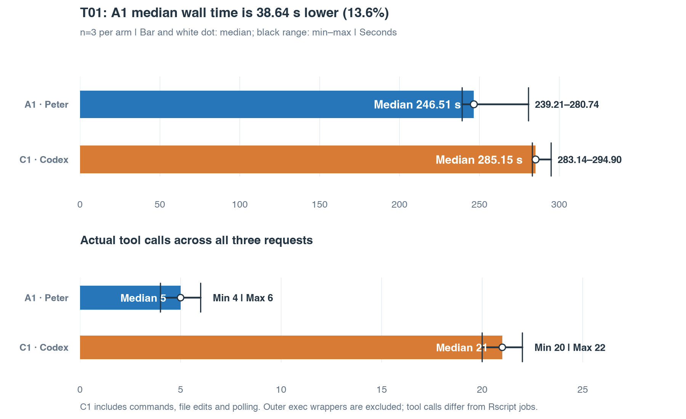
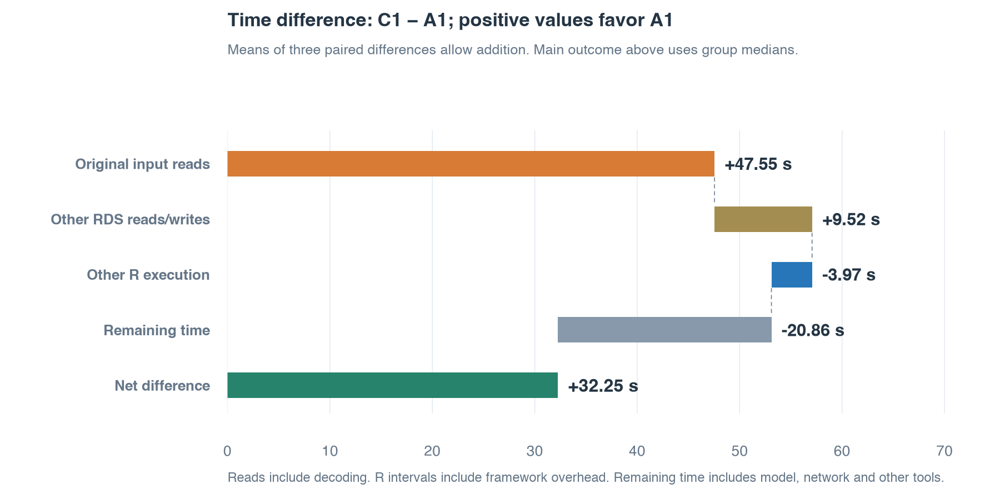
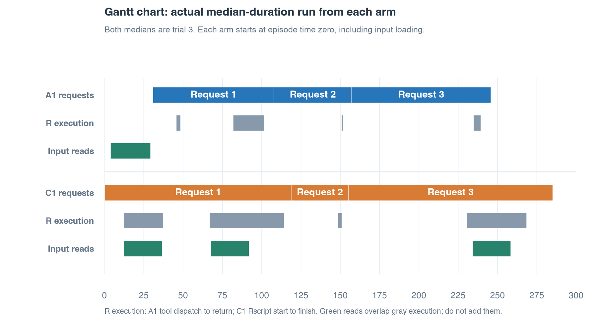

## A Total wall time and actual tool calls

**A1's median wall time was 38.64 seconds lower, a 13.6% reduction relative to C1.**
A1 finished sooner in all three matched pairs.

| Whole run | A1 · Peter | C1 · Native Codex |
|---|---:|---:|
| Median wall time | **246.51 s** | **285.15 s** |
| Minimum–maximum | 239.21–280.74 s | 283.14–294.90 s |
| Median actual tool calls | **5** | **21** |
| Call minimum–maximum | 4–6 | 20–22 |
| Original input reads | Once per run | Three times per run |

Wall time includes startup, input loading and cleanup; workspace input staging is excluded.
A1 counts Peter tool dispatches; C1 counts internal native tool invocations, including polling.
Outer exec wrappers are excluded from C1 counts.
These are observed results from three runs per arm, without runtime confidence intervals or a population significance claim.

## B Where the time difference comes from

Original input reads and other RDS operations together favor A1 by **57.07 seconds**.
Other components offset 24.82 seconds, leaving a **32.25-second mean net difference**.
This chart uses means of paired differences so its components add up.
Panel A uses group medians for the main outcome.

Reads include decompression and deserialization.
R execution intervals include adapter and framework overhead.
Remaining time includes model activity, network waits, startup and other tools; it does not isolate model reasoning time.
This accounting describes observed behavior and does not establish a causal effect of persistent state alone.

## C Execution Gantt chart

Both group medians correspond to trial 3.
Each timeline starts at episode launch, and requests execute sequentially: 1 → 2 → 3.

A1 retains R objects after loading.
C1 uses finite, one-shot Rscript processes and reuses completed files between executions.
The native Codex conversation retains text history.

All three C1 runs read the original input **2 / 0 / 1** times across the three requests.
Request 1 first inspects the data, then reloads it for computation.
Request 2 reads derived files; request 3 reloads the matrix for marker analysis.

Green bars show only `input.rds` reads.
R execution and read intervals overlap; do not add them together.

## D Configuration, tokens and verification

| Setting | Shared by both arms |
|---|---|
| Data | GSE236581 subset: 450,000 real cells, 36,027 genes, gzip RDS |
| Scientific requests | QC and composition → paired patient analysis → longitudinal, sensitivity and markers |
| User prompts | The same frozen three-request prompt profile |
| Model | gpt-6.1-sol, low reasoning effort |
| Hardware | 16 GiB RAM / 2 vCPU; 10 GiB R vector-heap limit |
| Budget | 2 million tokens and 1,200 seconds per run |
| Paired execution order | C1→A1; A1→C1; C1→A1 |

The C1 execution condition is recorded separately from the shared scientific prompts.
Interactive R, retained R processes, PTY command loops and R services are prohibited.
Empty polling of a finite Rscript job and reuse of completed files are allowed.

| Tokens: median [minimum–maximum] | A1 | C1 |
|---|---:|---:|
| Input, including cached input | 352,959 [255,142–454,044] | 522,046 [482,998–541,476] |
| Cached input subset | 299,136 [237,440–406,528] | 473,856 [461,184–509,696] |
| Output | 7,458 [6,968–8,913] | 8,596 [8,038–9,094] |

Tokens are cumulative for each run; they do not directly measure cost or model execution seconds.

Three fresh-process gzip reads took **23.569, 23.584 and 23.561 seconds**.
The operating system cache was not cleared.
All six runs completed.

Independent checks covered QC, compositions, effects, P values, FDR, markers and primary, longitudinal and sensitivity bootstrap intervals.
Artifact coverage, plots and narratives were reviewed; optional audit columns and individual pixels were not exhaustively reconstructed.
All 12 observed C1 Rscript jobs ended within their respective requests, with native commands and generated R scripts also reviewed.

Run identifier: `v05-T01-dev20-one-shot-confirmation-20261104T065528Z`.
The measured source is **dev.20**; the cleaned repository runner is dev.21 and has no new live measurements in this report.
Earlier dev.15 and unrestricted dev.18/19 results are excluded from these summaries.

[All six attempts](t01-results-current/all-attempts.csv) · [Group statistics](t01-results-current/group-statistics.csv) · [Additive differences](t01-results-current/additive-mean-differences.csv) · [Source hashes and review scope](t01-results-current/provenance.json) · [Exact shared prompts](t01-results-current/shared-prompts.json)

Raw experimental records remain at their original paths in the local, Git-ignored runs directory.
The public files contain aggregate measurements and source hashes, without raw session transcripts or patient records.
