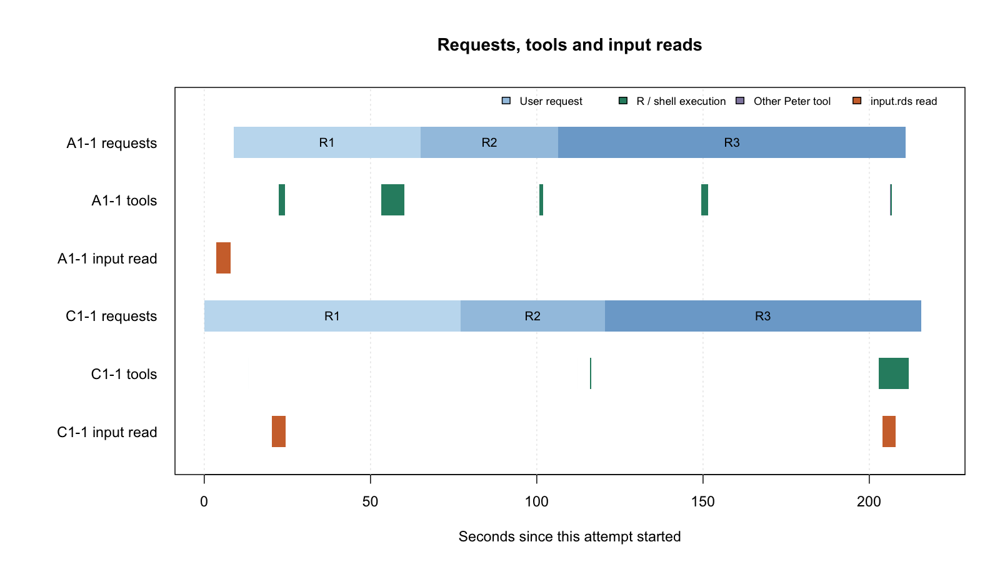

A1 used **6 tool calls in every run**. C1 used **13, 11 and 14 calls**.
Median wall times differed by **4.35 seconds**.

## A Total time for three requests

A1 median: **211.31 seconds**. C1 median: **215.66 seconds**.

A1 uses Peter with a persistent R session. C1 uses native Codex.
All six runs appear below in execution order.

```chart bar horizontal unit=s
A1-1 | 211.31
C1-1 | 215.66
C1-2 | 204.17
A1-2 | 210.35
A1-3 | 222.58
C1-3 | 235.85
```

Wall time includes startup, input loading, model interaction, tool execution and finalization.
This report focuses on agent execution behavior.
Three runs per arm do not establish a consistent performance advantage.

## B Actual function / tool call counts

```chart bar horizontal unit=calls
A1-1 | 6
C1-1 | 13
C1-2 | 11
A1-2 | 6
A1-3 | 6
C1-3 | 14
```

```chart bar horizontal unit=calls
 | R execution | Shell commands | stdin / polling | File writes | Image viewing
A1-1 | 5 | 0 | 0 | 1 | 0
C1-1 | 0 | 7 | 6 | 0 | 0
C1-2 | 0 | 7 | 4 | 0 | 0
A1-2 | 5 | 0 | 0 | 1 | 0
A1-3 | 5 | 0 | 0 | 1 | 0
C1-3 | 0 | 8 | 6 | 0 | 0
```

A1 counts actual gptr tool dispatches. C1 counts internal tool invocations from the original Codex session.
Outer exec wrappers are not counted again. Progress queries count as tool calls.

C1's additional calls cover environment discovery, stdin interaction or polling, and error recovery.
Each C1 run had one recovered tool error. A1 had none.
Each A1 run still included one separate final validation call.

These are neither internal R function counts nor model API request counts.
One C1 shell command can compute, plot and write a report.
Equal call counts therefore need not represent equal amounts of work.

## C Calls and time by request

**A1: calls per request**

```chart bar horizontal unit=calls
 | Request 1 | Request 2 | Request 3
A1-1 | 2 | 1 | 3
A1-2 | 2 | 1 | 3
A1-3 | 2 | 1 | 3
```

**A1: seconds per request**

```chart bar horizontal unit=s
 | Request 1 | Request 2 | Request 3
A1-1 | 56.11 | 41.45 | 104.45
A1-2 | 61.21 | 41.06 | 98.79
A1-3 | 56.62 | 40.93 | 115.75
```

**C1: calls per request**

```chart bar horizontal unit=calls
 | Request 1 | Request 2 | Request 3
C1-1 | 8 | 3 | 2
C1-2 | 7 | 1 | 3
C1-3 | 9 | 1 | 4
```

**C1: seconds per request**

```chart bar horizontal unit=s
 | Request 1 | Request 2 | Request 3
C1-1 | 77.18 | 43.27 | 95.21
C1-2 | 74.22 | 38.0 | 91.94
C1-3 | 84.78 | 38.67 | 112.41
```

Request durations already include tool execution. Do not add them together.
Time outside recorded tool intervals includes generation, network delays and service waits.
Those gaps cannot all be labeled model thinking time.

**A1: tool execution accounts for a small part of wall time**

```chart bar horizontal unit=s
 | Sum of tool intervals | Total wall time
A1-1 | 12.27 | 211.31
A1-2 | 14.59 | 210.35
A1-3 | 14.27 | 222.58
```

Fewer calls do not guarantee a proportional reduction in wall time.
Input loading, generation, networking and service waits also contribute.
The records do not separate model reasoning from network latency precisely.
C1 uses asynchronous processes, so A1's interval-sum method is not directly comparable.

## D Three-lane Gantt overview

Representative runs: **A1-1 and C1-1**, the median-duration run in each arm.



Each arm has three lanes: requests, tools and original input reads.
Only intervals with both recorded endpoints are drawn. Missing endpoints are not inferred.

C1's tool lane shows command lifetimes, including interactive-process waits.
It does not measure pure compute time. Individual stdin queries are not drawn in that lane.
Short calls can be hard to see; counting visible bars will undercount tool calls.

Actual counts: **6 for A1-1**, **13 for C1-1**.
The input lane shows only input.rds reads, excluding other cache files.

## E Recovery and cache overhead

**Tool errors, including errors that were later recovered**

```chart bar horizontal unit=errors
A1-1 | 0
C1-1 | 1
C1-2 | 1
A1-2 | 0
A1-3 | 0
C1-3 | 1
```

**Recorded RDS operations, including cache files**

```chart bar horizontal unit=s
 | Read / deserialize | Write / serialize
A1-1 | 4.33 | 0
C1-1 | 8.14 | 0
C1-2 | 12.57 | 6.82
A1-2 | 4.31 | 0
A1-3 | 4.33 | 0
C1-3 | 21.09 | 10.46
```

These durations are already included in wall time.
They cover recorded RDS operations, including serialization, rather than pure disk I/O.
The operating system cache was not cleared.

**A1: 6 calls in each run.**
Request 1 inspects input, then combines validation, QC, aggregation and output writing.
Request 2 combines paired analysis and plotting while reusing session objects.
Request 3 combines analysis and outputs, writes the report, then performs a separate final check.
None of the three runs required tool-error recovery.

**C1-1: 13 calls, split 8 / 3 / 2.**
Request 3 already combined related operations.
Request 2 failed to reuse an interactive R process from the preceding request: the process ID was no longer available.
The agent recovered by starting a new Rscript process and reading the saved composition CSV.
The original input was read again in Request 3.

**C1-2: 11 calls, split 7 / 1 / 3.**
An existence check found R's built-in raw function instead of the intended data object.
The agent corrected the check and reran the computation.
It read input.rds once, but read a saved copy of the large matrix twice more.
Counting only input.rds reads would overstate data reuse.

**C1-3: 14 calls: 8 commands and 6 progress queries.**
Request 1 incorrectly rejected the stored matrix class through an identical comparison.
The agent changed the class-membership check and reran the step.
Request 3 reread the original matrix and queried progress three times.

## F Scope and supporting data

Both arms received the same user prompts, model and input data.
Source code stayed fixed across the six runs. No run was replaced by a later attempt.
Collection included lightweight status queries and downloads of completed artifacts.

This experiment used dev.15 before the repository extraction; the current runner is dev.16.
Run identifier: `v05-T01-formal-20261103T204530Z`.
Model: `gpt-6.1-sol`, low reasoning effort.

Biomedical result scoring is outside this report's focus.
Execution completion does not establish scientific correctness: A1-1 used QC-filtered cells for marker evidence.
The six results were not independently recomputed in full. This report does not claim that all scientific outputs passed review.

[Metric data](t01-formal-current/agent-metrics.csv) · [Request timings](t01-formal-current/request-timings.csv) · [Shared prompts](../aws/prompts.json)

The public files contain aggregate measurements without machine-specific paths or raw session transcripts.
Full raw records remain in the local, Git-ignored runs directory.
