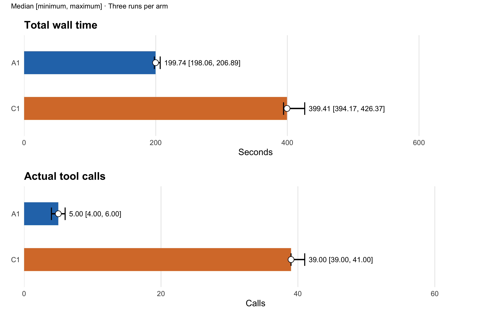
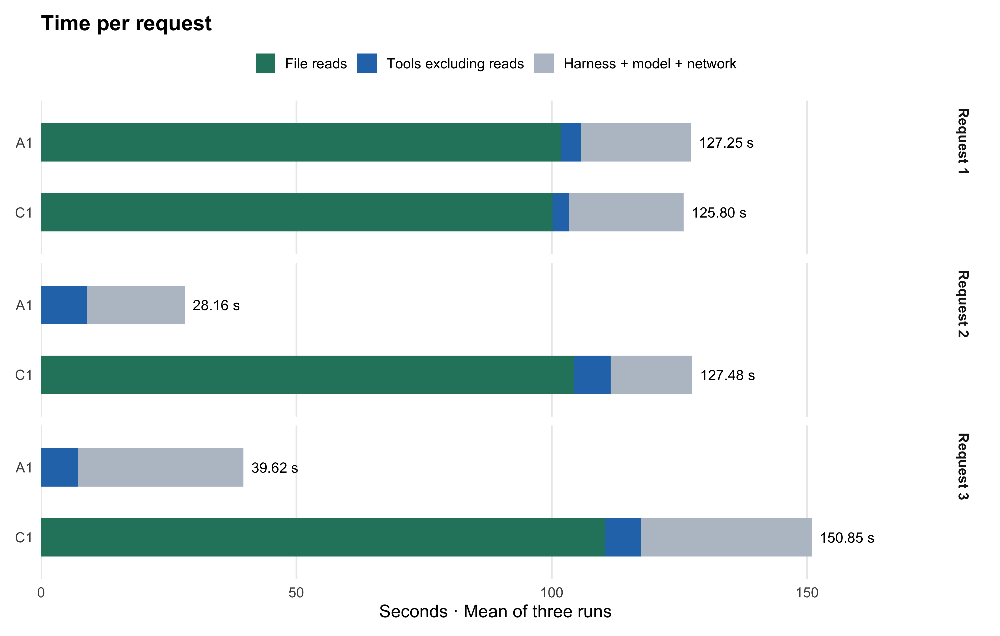
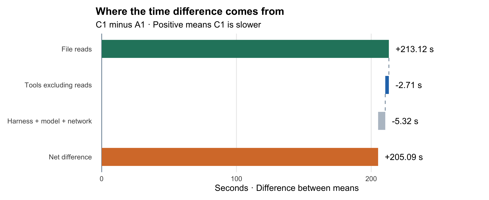
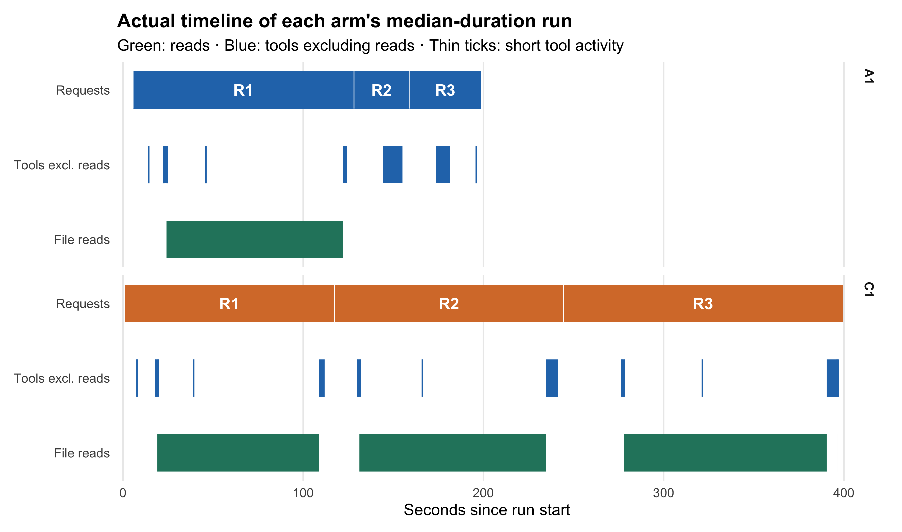

T08 Results: Full-File mzML Reading and Cross-Request Reuse
================

- [A Total wall time and tool calls](#a-total-wall-time-and-tool-calls)
- [B Where does the time saving come
  from?](#b-where-does-the-time-saving-come-from)
- [C Gantt chart and repeated reads](#c-gantt-chart-and-repeated-reads)
- [D Tokens, conditions, and
  validation](#d-tokens-conditions-and-validation)

[Methods](method.md)

## A Total wall time and tool calls

**Median wall time: A1 199.74 s; C1 399.41 s.** A1 takes 199.68 seconds
less, a 49.99% reduction relative to C1’s median. Each arm has three
runs; we show the median, minimum, and maximum. We show no confidence
intervals and make no population-level significance claim.

Wall time is in seconds; peak memory is in GiB.

    ##               metric arm     median    minimum    maximum
    ## 7             wall_s  A1 199.738648 198.055583 206.886069
    ## 8             wall_s  C1 399.414241 394.172360 426.368196
    ## 9       actual_calls  A1   5.000000   4.000000   6.000000
    ## 10      actual_calls  C1  39.000000  39.000000  41.000000
    ## 11 r_execution_calls  A1   3.000000   3.000000   3.000000
    ## 12 r_execution_calls  C1   3.000000   3.000000   3.000000
    ## 13       input_reads  A1   1.000000   1.000000   1.000000
    ## 14       input_reads  C1   3.000000   3.000000   3.000000
    ## 23          peak_gib  A1  10.521290  10.502960  10.539818
    ## 24          peak_gib  C1   9.765873   8.784473   9.767136

C1 calls include commands, file edits, and polling; outer exec wrappers
are not counted twice.

C1 polling waits for finite Rscript processes to finish. A1 R executions
count R tool calls; C1 R executions count separate Rscript processes.

## B Where does the time saving come from?

**File reads account for the main mean difference: C1 spends 213.12
seconds more.** Other tool activity and harness/model time together
offset this by 8.02 seconds. The net mean difference is 205.09 seconds.

Each request has three non-overlapping time categories. Stacked bars use
means across three runs, so their parts sum to mean request time.

File reads include mzML opening, metadata parsing, peak decoding, and
recorded result-table reads. Other tool activity includes computation,
output writing, and tool overhead. The residual combines harness, model
thinking, generation, and network waiting.

mzR peaks calls header internally; we take the union of all read
intervals. Finite C1 Rscript activity counts even when it spans multiple
polling calls. We allocate read time first, then other tool activity,
then the residual. The residual is not a separate measurement of model
thinking time.

Positive values mean C1 is slower; negative values mean C1 is faster.
This chart uses additive mean differences; Part A uses the difference
between medians. Startup, inter-request gaps, and cleanup belong to the
whole-episode residual. We do not assign time outside requests to
individual requests.

## C Gantt chart and repeated reads

Representative runs: A1 trial 3 and C1 trial 3. Green bars show file
reads; blue bars show tool activity excluding reads. Intervals retain
their actual durations. Short activities appear as thin ticks.
Overlapping tool activity is merged, so bar counts do not represent call
counts.

The requests perform a full-load audit, an intensity summary, and a
peak-count/base-peak summary. Each request requires the complete spectra
and peak arrays in R memory. A1 can retain objects in memory; C1 uses
finite native Rscript processes that exit after execution. Both arms
prohibit extra intermediate data and state caches on disk. Scientific
outputs comprise three small summary tables and one text report.

Complete peak-array reads per request:

    ##   request arm input_reads.median input_reads.min input_reads.max
    ## 1       1  A1                  1               1               1
    ## 2       2  A1                  0               0               0
    ## 3       3  A1                  0               0               0
    ## 4       1  C1                  1               1               1
    ## 5       2  C1                  1               1               1
    ## 6       3  C1                  1               1               1

[Per-request timing](data/request-stages.csv) · [Full
timeline](data/timeline.csv)

## D Tokens, conditions, and validation

    ##                     metric arm median minimum maximum
    ## 15            input_tokens  A1 405652  362949  526980
    ## 16            input_tokens  C1 979607  877644 1000811
    ## 17     cached_input_tokens  A1 360960  337024  487808
    ## 18     cached_input_tokens  C1 944256  849920  967552
    ## 19           output_tokens  A1   2682    2540    2701
    ## 20           output_tokens  C1   4272    4241    4509
    ## 21 reasoning_output_tokens  A1     57      39      63
    ## 22 reasoning_output_tokens  C1    132      92     139

Cached input tokens are a subset of input tokens; reasoning tokens are a
subset of output tokens. Token counts do not measure thinking time.

[MassIVE
MSV000100943](https://massive.ucsd.edu/ProteoSAFe/dataset.jsp?task=39baaabaea894f3a9835e00a5e756431):
one native plasma-proteomics mzML file (CC0). Both arms ran on the same
16 GiB / 2 vCPU host. Timing excludes input copying, downloads, and
installation. OS caches were not cleared; this is not a cold-disk
benchmark.

    ##                  condition                                      value
    ## 1        benchmark_version                               0.5.0-dev.24
    ## 2                    model                                gpt-6.1-sol
    ## 3         reasoning_effort                                        low
    ## 4            codex_version                          codex-cli 0.165.0
    ## 5 codex_r_execution_policy                           one-shot-rscript
    ## 6                 platform Linux-7.0.0-1014-aws-x86_64-with-glibc2.39
    ## 7                   python                                     3.12.3

    ##   input_format input_bytes spectra total_peaks
    ## 1         mzml  6415611632  307590   512278842

**All six runs completed and passed numerical and execution-policy
review.** Review covered full-data scope, three result tables, scripts,
artifacts, and execution traces for all six runs. Independent full-data
recomputation checked every requested summary at a tolerance of 1e-10.
This experiment adds no protein identification, clinical inference, or
downstream biological analysis.

This benchmark measures full-file reading and memory reuse across
requests. Its results apply to this scenario, not to every task.

Input SHA256:
6ef5aa3593887a58247bffde511ac201641a5d54360fb0153bbdeaa0614d2f69. Raw
batch: v05-T08-dev24-native-20261104. [All six
runs](data/all-attempts.csv) · [Provenance and
hashes](trace/provenance.json) · [Local validation
record](trace/final-review.json)
