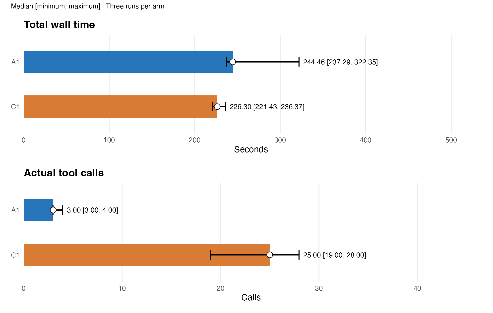
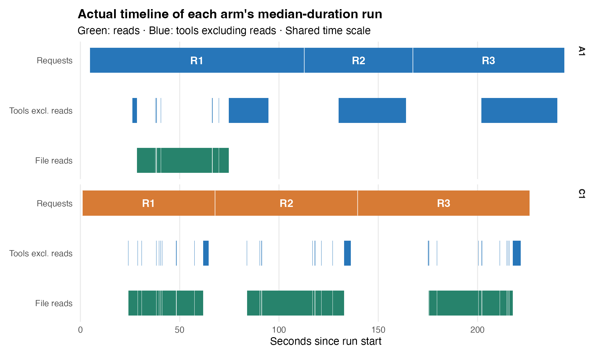

# T03 — RNA input reuse, results and offline replay

Compare **A1: persistent R memory through gptr** with **C1: finite native Rscript processes**, using three sequential requests and three trials per arm. Both arms receive the same scientific prompts. No extra intermediate data caches are permitted.

## Results

| Batch | gptr source | Median A1 / C1 wall time | Report |
|---|---|---|---|
| Latest | 1.0.1 development snapshot, `5e2992b` | 244.46 / 226.30 s | [Results and figures](gptr-1.0.1/report.md) · [HTML](gptr-1.0.1/report.html) |
| Previous dev.30 | 1.0.0 snapshot, content matches `85c7201` | 223.41 / 222.11 s | [Results](gptr-1.0.0-dev30/report.md) · [HTML](gptr-1.0.0-dev30/report.html) |
| Historical dev.29 | 1.0.0 snapshot, content matches `85c7201` | 226.90 / 303.76 s | [Results](gptr-1.0.0-dev29/report.md) · [HTML](gptr-1.0.0-dev29/report.html) |

The historical dev.29 batch includes C1 error recovery; do not pool these batches. The latest version is a pinned development commit, not an official 1.0.1 release.





In the latest batch A1 reads the complete inputs once; C1 reads them in each request. Mean read savings of 86.71 s are outweighed by 97.56 s of additional non-reading tool time and 29.15 s of additional harness/model/network time: A1 takes 40.00 s longer on average. Only three trials per arm were run.

**Investigation target:** A1-2 request 2 has a 34.08 s outer tool interval but reports 4.18 s inside execution; request 3 has 38.37 s versus 2.35 s. This is an observed boundary difference, not evidence identifying its cause. [Timing evidence](replay/tool-timing.csv).

## Inspect or replay

- [Replay instructions](replay/README.md), starting with A1-2, the A1 trial displayed in the Gantt.
- [Recorded model outputs](replay/A1-2/messages.md), [event trace](replay/A1-2/trace.jsonl), [ordinary R code](replay/A1-2/ordinary.R), [Peter replay document](replay/A1-2/recorded.R).
- Six trials' public event/read traces; all three A1 trials include offline replay documents. C1 traces preserve recorded tool commands and returns; no automated C1 replay wrapper is supplied.
- [Shared scientific prompts](metadata/shared-prompts.json), [run configuration](metadata/manifest.json), [installed R packages](metadata/runtime-packages.txt), [version provenance](metadata/gptr-version.json).

Replay executes the recorded code **without new model requests**. It requires the original inputs and compatible R dependencies. It does not reproduce the historical model/network/harness waits. The original experiment recorded events; the Peter replay documents were derived later from unchanged tool inputs with an offline provider. Document generation used checkpoint off. This does not change the original experiment's settings or timings.

```bash
# Keep gptr source outside this benchmark repository.
git clone https://github.com/Broccolito/gptr.git /path/to/external-gptr
git -C /path/to/external-gptr checkout 5e2992b13824fbf5218428d379a336dd44acddbb
# Install that checkout's DESCRIPTION dependencies, plus pkgload, jsonlite and data.table.
export GPTR_SOURCE=/path/to/external-gptr
cd biomedical/v0.5/reports/T03
python3 inputs/download.py /path/to/T03-inputs
Rscript --vanilla replay/replay.R /path/to/T03-inputs /path/to/new-replay-work A1-2
```

Use a new replay work directory. The recorded code writes its requested results there. No final scientific outputs or large raw datasets are bundled here.

## Inputs and editable figures

The complete input is **1,231 public TCGA-BRCA GDC STAR Counts TSV files**, 5,223,473,855 bytes in total. Each file contains 60,664 rows and nine columns, including four STAR summary rows. These are file-level descriptive summaries, not differential-expression or patient-level inference.

[Input manifest](inputs/manifest.csv) freezes each GDC download URL and SHA-256. The downloader checks every file and restores the exact [input list](inputs/input-files.txt). Raw biological data are downloaded from GDC rather than stored in Git. Downloading needs network access; replay itself does not call a model. Reading alone retains several GB of data, with additional R overhead.

The report's small CSV data, PNG figures and ggplot2 source are all included. To redraw the latest figures with R packages `ggplot2` and `patchwork` installed:

```bash
Rscript --vanilla gptr-1.0.1/figures/plot.R gptr-1.0.1/figures
```

GitHub renders the Markdown and PNGs directly. Download/clone the folder and open `report.html` locally for the interactive full-screen figure view.

## Public-copy provenance

Original records remain unchanged in the local archive. Public copies remove internal system/developer instruction content, account identifiers and personal home paths; redundant native session and transport logs are omitted. Recorded model outputs mean what the benchmark captured, not unavailable internal thinking or a complete token stream. Experimental prompts and C1 execution policy remain documented.

[PROVENANCE.json](PROVENANCE.json) records source paths and original/published hashes; [SHA256.json](SHA256.json) covers every published file except the checksum file itself. Original source archive SHA-256: `9df795421486f9fc5a8e6bf56a2855a993b6dcb41b7e2a822ffc85b786cc8000`; original formal-record archive SHA-256: `7e8bd766f2de9561d0ff697b5913a5a020b2c77da6979518aa4b721d6748df80`.
