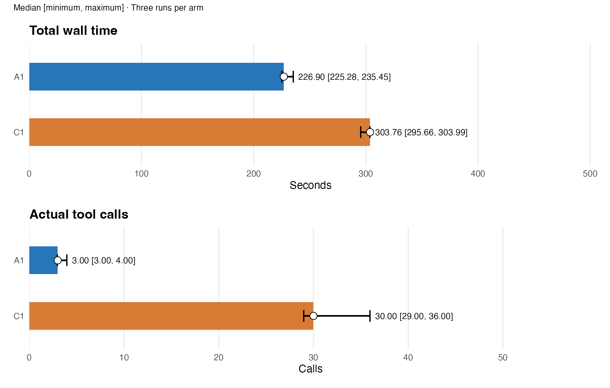
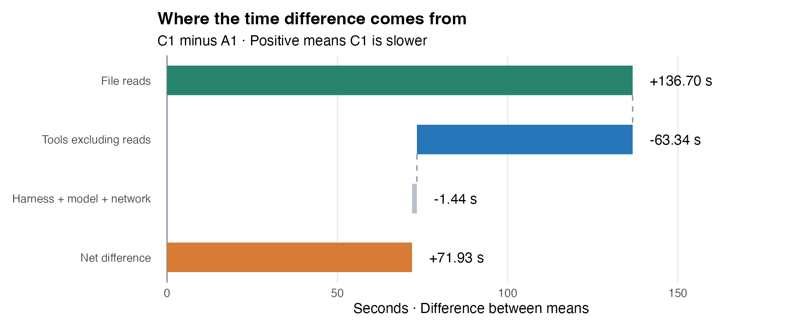
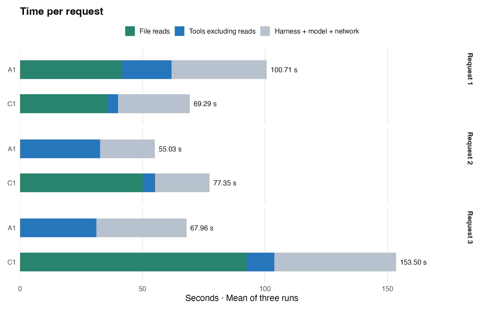
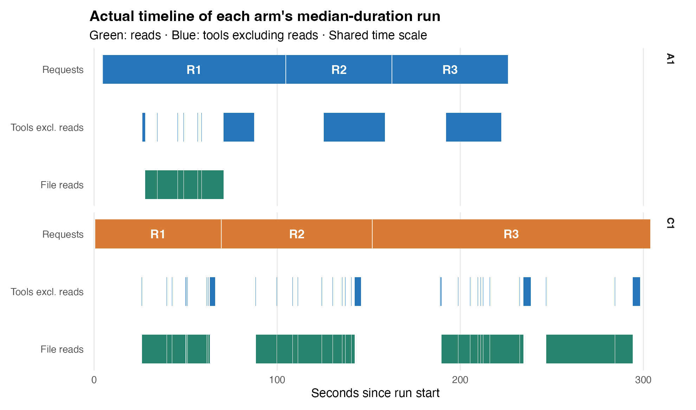

## A 总耗时与调用次数

**gptr 1.0.0 源码快照** · commit [`85c72019add6`](https://github.com/Broccolito/gptr/commit/85c72019add63ca4927923c6a5d08a715d3c708a)。
包源码哈希与该干净提交一致；不是按 CRAN 发布包安装。

**总耗时中位数：A1 226.90 秒，C1 303.76 秒。**
C1 − A1 为 +76.86 秒，A1 中位数低 25.3%。

**本批 C1 三次均发生第三轮类型错误重试；总差异不是纯复用收益。**

A1 为 GPT-R 持久 R 会话；C1 为原生 Codex 单次 Rscript。
每组仅三次，展示中位数、最小值和最大值，不画置信区间。

| 指标：中位数 [最小, 最大] | A1 | C1 |
|---|---|---|
| 总耗时 / 秒 | 226.90 [225.28, 235.45] | 303.76 [295.66, 303.99] |
| 实际工具调用 | 3.00 [3.00, 4.00] | 30.00 [29.00, 36.00] |
| R 执行次数 | 3.00 [3.00, 3.00] | 4.00 [4.00, 4.00] |
| 进程树峰值 / GiB | 10.23 [9.60, 10.85] | 6.27 [6.20, 6.54] |

实际调用包含命令、编辑和轮询，不重复计外层 exec。

## B 时间差来自哪里

C1 − A1：读取 +136.70 秒；工具非读取 -63.34 秒。
harness、模型和网络合计 -1.44 秒。
三项相加为 +71.93 秒。
正值表示 C1 更慢；这里用可相加的均值差。

读取包含原生文件解析，不等同于纯磁盘 I/O。
function call 扣除读取后，计入工具非读取时间。
该项含工具内部开销，不能全部解释为科学计算。
其余包含框架、thinking、吐字和网络等待。
启动、请求间隙与清理也计入全程其余时间。

## C 甘特图与读取复用

各组选取自身中位耗时的一次运行，使用相同时间尺度。
绿色为读取，蓝色为工具非读取；两组共用时间尺度。
A1 三次均只在第一轮读取 1,231 个原始文件。C1 每次读取四遍：第一、二轮各一遍，第三轮因重试读取两遍。

C1 第三轮回读结果表时，将大整数推断为 integer64。
环境未安装 bit64，数值核对因此失败；修正读法后重新执行。
每次重试均再次完整读取原始数据；这部分计入实际总耗时。

失败 Rscript 区间含读取与检查，不能直接当作纯错误恢复成本。
[逐请求读取与失败执行](figures/execution-details.csv)

## D token 与结果复核

| token：中位数 [最小, 最大] | A1 | C1 |
|---|---|---|
| 输入 | 324,957.00 [260,217.00, 377,820.00] | 638,491.00 [609,974.00, 800,247.00] |
| 其中缓存输入 | 301,312.00 [237,696.00, 321,408.00] | 608,000.00 [577,280.00, 755,456.00] |
| 输出 | 2,857.00 [2,749.00, 3,048.00] | 4,873.00 [4,733.00, 5,054.00] |
| 其中 reasoning | 35.00 [20.00, 51.00] | 97.00 [81.00, 213.00] |

缓存输入和 reasoning 是子集，不重复相加。

**六次运行均完成三轮；全部结果表与独立复算一致。**
已检查完整读取、指定产物和 C1 单次进程退出。A1 三次无工具错误；C1 三次各有一次类型错误恢复。最大运行进程树峰值约 10.85 GiB，接近 11 GiB 保护阈值。

模型：gpt-6.1-sol，reasoning：low。
本批仅作描述性比较，不推断通用优势。
未清空操作系统缓存；预跑不计入正式结果。

[逐次数据](figures/all-attempts.csv) · [工具调用明细](figures/calls-by-tool.csv) · [逐请求耗时](figures/request-stages.csv) · [来源与哈希](figures/provenance.json)

原始批次：`v05-T03-formal-20261106-dev29`。
