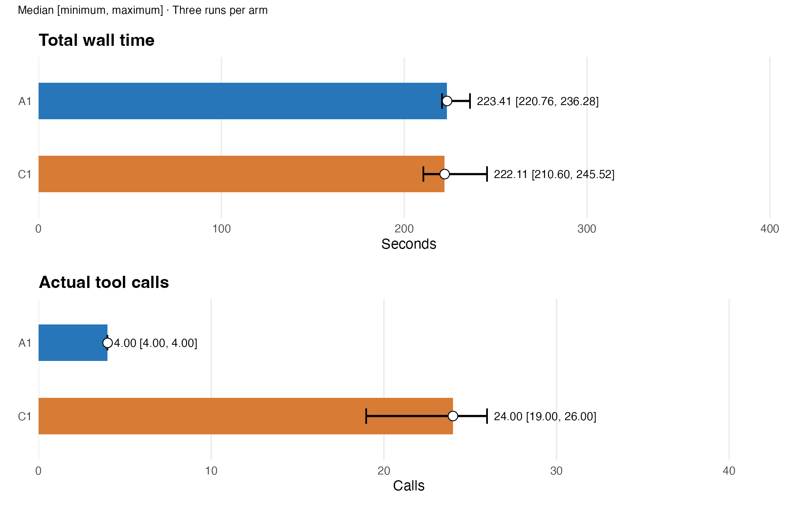
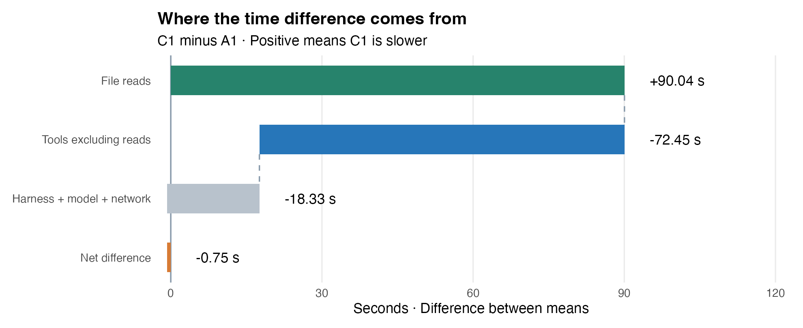
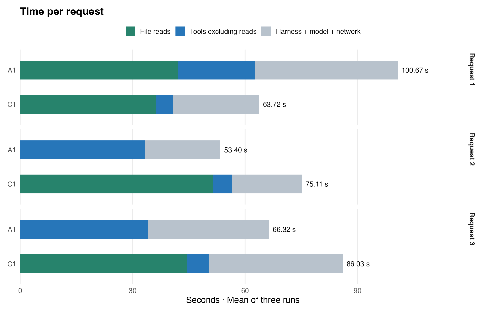
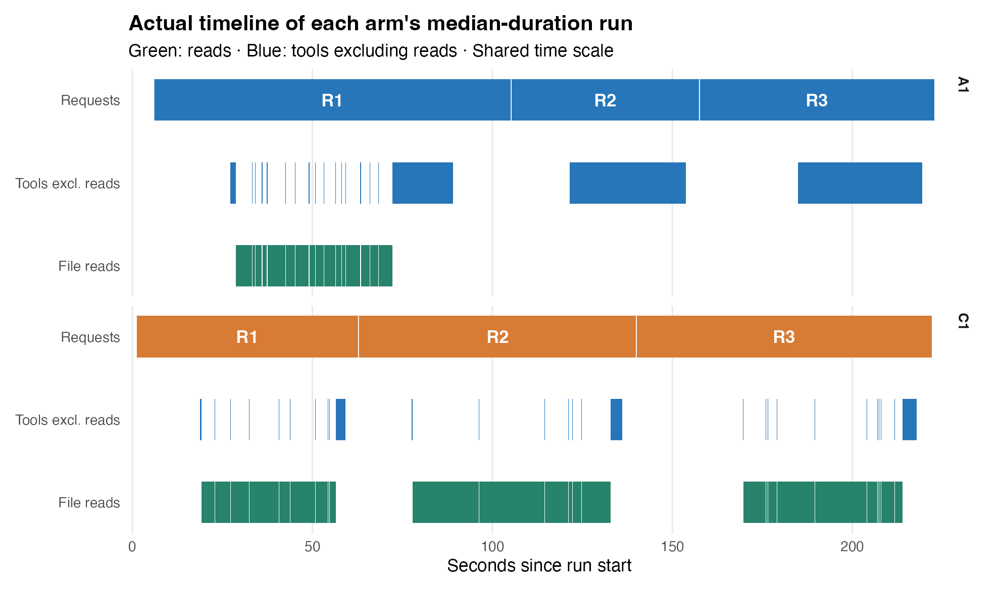

## A 总耗时与调用次数

**gptr 1.0.0 源码快照** · commit [`85c72019add6`](https://github.com/Broccolito/gptr/commit/85c72019add63ca4927923c6a5d08a715d3c708a)。
包源码哈希与该干净提交一致；不是按 CRAN 发布包安装。

**总耗时中位数：A1 223.41 秒，C1 222.11 秒。**
C1 − A1 为 -1.31 秒，A1 中位数高 0.6%。

**读取复用成立，但本批没有总耗时优势。**
A1 少读两遍输入，节省的读取时间被其他开销抵消。

A1 为 GPT-R 持久 R 会话；C1 为原生 Codex 单次 Rscript。
每组仅三次，展示中位数、最小值和最大值，不画置信区间。

| 指标：中位数 [最小, 最大] | A1 | C1 |
|---|---|---|
| 总耗时 / 秒 | 223.41 [220.76, 236.28] | 222.11 [210.60, 245.52] |
| 实际工具调用 | 4.00 [4.00, 4.00] | 24.00 [19.00, 26.00] |
| R 执行次数 | 3.00 [3.00, 3.00] | 3.00 [3.00, 3.00] |
| 进程树峰值 / GiB | 9.59 [9.58, 9.91] | 6.23 [6.21, 6.82] |

实际调用包含命令、编辑和轮询，不重复计外层 exec。

## B 时间差来自哪里

C1 − A1：读取 +90.04 秒；工具非读取 -72.45 秒。
harness、模型和网络合计 -18.33 秒。
三项相加为 -0.75 秒。
正值表示 C1 更慢；这里用可相加的均值差。

读取包含原生文件解析，不等同于纯磁盘 I/O。
function call 扣除读取后，计入工具非读取时间。
该项含工具内部开销，不能全部解释为科学计算。
其余包含框架、thinking、吐字和网络等待。
启动、请求间隙与清理也计入全程其余时间。

## C 甘特图与读取复用

各组选取自身中位耗时的一次运行，使用相同时间尺度。
绿色为读取，蓝色为工具非读取；两组共用时间尺度。
三次 A1 均只在第一轮读取全部 1,231 个文件。
三次 C1 均在每轮重新读取全部文件。
图中细碎线段来自逐文件读取间隙，未人为放大。

本批没有失败执行或重试。
运行前已补齐两组共用的 bit64 依赖。
[旧 dev.29 报告](../gptr-1.0.0-dev29/report.html) 单独保留，不混入统计。

[逐请求读取与失败执行](figures/execution-details.csv)

## D token 与结果复核

| token：中位数 [最小, 最大] | A1 | C1 |
|---|---|---|
| 输入 | 360,410.00 [276,591.00, 361,465.00] | 505,627.00 [445,911.00, 613,262.00] |
| 其中缓存输入 | 331,392.00 [255,104.00, 334,208.00] | 482,304.00 [429,056.00, 590,336.00] |
| 输出 | 2,830.00 [2,824.00, 2,958.00] | 4,073.00 [3,667.00, 4,348.00] |
| 其中 reasoning | 41.00 [32.00, 70.00] | 86.00 [79.00, 140.00] |

缓存输入和 reasoning 是子集，不重复相加。

**六次运行、18 张结果表均通过独立逐单元格复算。**
三次 A1 均复用内存；九个 C1 Rscript 全部正常退出。
未发现额外科学缓存，也没有失败执行或重试。
输入与外部 gptr 源码哈希在实验前后保持一致。

模型：gpt-6.1-sol，reasoning：low。
本批仅作描述性比较，不推断通用优势。
未清空操作系统缓存；预跑不计入正式结果。

[逐次数据](figures/all-attempts.csv) · [工具调用明细](figures/calls-by-tool.csv) · [逐请求耗时](figures/request-stages.csv) · [来源与哈希](figures/provenance.json)

原始批次：`v05-T03-formal-20261107-dev30`。
