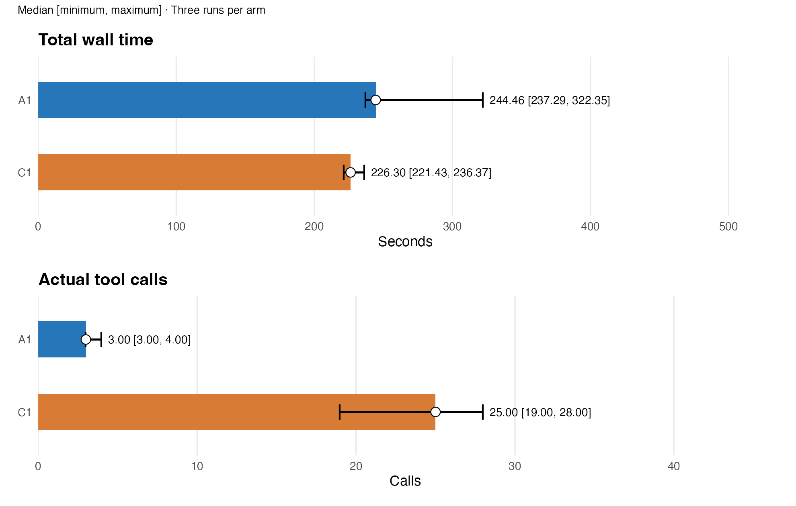
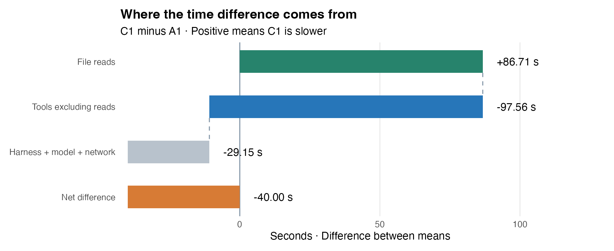
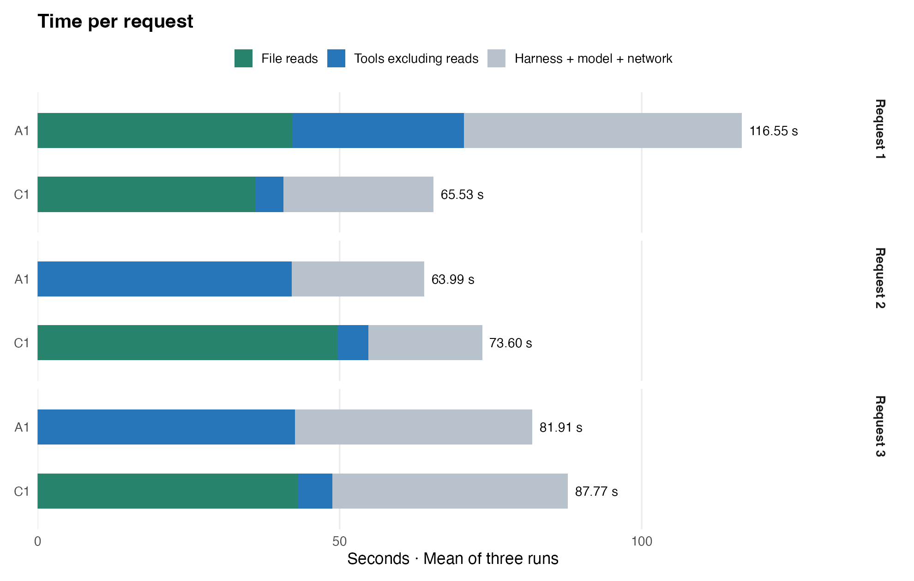
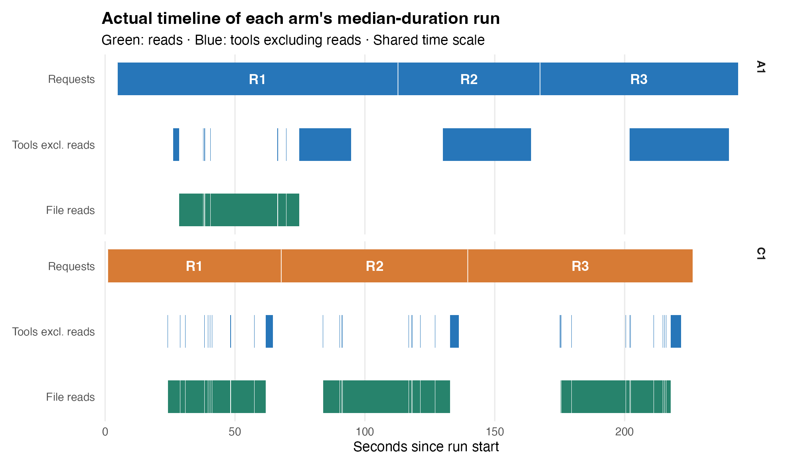

## A 总耗时与调用次数

**gptr 1.0.1 开发版** · commit [`5e2992b13824`](https://github.com/Broccolito/gptr/commit/5e2992b13824fbf5218428d379a336dd44acddbb)。
固定 GitHub commit；不是 CRAN 正式 release。

**总耗时中位数：A1 244.46 秒，C1 226.30 秒。**
C1 − A1 为 -18.17 秒，A1 中位数高 8.0%。

**本批 A1 总耗时更长，读取复用没有带来净节省。**
A1 第一次为 322.35 秒，另外两次为 244.46 和 237.29 秒。
三次全部保留，不剔除最慢运行。

A1 为 GPT-R 持久 R 会话；C1 为原生 Codex 单次 Rscript。
每组仅三次，展示中位数、最小值和最大值，不画置信区间。

| 指标：中位数 [最小, 最大] | A1 | C1 |
|---|---|---|
| 总耗时 / 秒 | 244.46 [237.29, 322.35] | 226.30 [221.43, 236.37] |
| 实际工具调用 | 3.00 [3.00, 4.00] | 25.00 [19.00, 28.00] |
| R 执行次数 | 3.00 [3.00, 3.00] | 3.00 [3.00, 3.00] |
| 进程树峰值 / GiB | 10.54 [10.45, 10.81] | 6.56 [6.21, 6.83] |

实际调用包含命令、编辑和轮询，不重复计外层 exec。

## B 时间差来自哪里

C1 − A1：读取 +86.71 秒；工具非读取 -97.56 秒。
harness、模型和网络合计 -29.15 秒。
三项相加为 -40.00 秒。
正值表示 C1 更慢；这里用可相加的均值差。

读取包含原生文件解析，不等同于纯磁盘 I/O。
function call 扣除读取后，计入工具非读取时间。
该项含工具内部开销，不能全部解释为科学计算。
其余包含框架、thinking、吐字和网络等待。
启动、请求间隙与清理也计入全程其余时间。

## C 甘特图与读取复用

各组选取自身中位耗时的一次运行，使用相同时间尺度。
绿色为读取，蓝色为工具非读取；两组共用时间尺度。
三次 A1 均只在第一轮读取全部 1,231 个文件。
三次 C1 均在每轮重新读取全部文件。
细碎线段来自逐文件读取间隙，未人为放大。

本批没有失败执行或重试。
两组 R 执行次数均为三次；调用总数还包含发现工具和轮询。
A1 工具内部非读取开销较高，不能全部解释为科学计算。

[逐请求读取与失败执行](figures/execution-details.csv)

## D token 与结果复核

| token：中位数 [最小, 最大] | A1 | C1 |
|---|---|---|
| 输入 | 308,235.00 [283,702.00, 642,438.00] | 590,004.00 [411,307.00, 601,515.00] |
| 其中缓存输入 | 274,560.00 [260,992.00, 606,720.00] | 564,096.00 [372,608.00, 574,976.00] |
| 输出 | 3,147.00 [3,050.00, 3,664.00] | 4,256.00 [4,068.00, 4,537.00] |
| 其中 reasoning | 27.00 [21.00, 72.00] | 115.00 [93.00, 170.00] |

缓存输入和 reasoning 是子集，不重复相加。

**六次运行、18 张结果表均通过独立逐单元格复算。**
三个 A1 均完整读取一次；九个 C1 Rscript 全部正常退出。
未发现额外科学缓存，也没有失败执行或重试。
输入与 gptr 源码哈希在实验前后保持一致。

模型：gpt-6.1-sol，reasoning：low。
本批仅作描述性比较，不推断通用优势。
未清空操作系统缓存；预跑不计入正式结果。

[逐次数据](figures/all-attempts.csv) · [工具调用明细](figures/calls-by-tool.csv) · [逐请求耗时](figures/request-stages.csv) · [来源与哈希](figures/provenance.json)

原始批次：`v05-T03-formal-20261107-gptr101`。

## E 新旧版本对应关系

| gptr 源码 | A1 中位数 / 秒 | C1 中位数 / 秒 | C1 − A1 / 秒 |
|---|---:|---:|---:|
| [1.0.0 快照 · 85c72019add6](../gptr-1.0.0-dev30/report.html) | 223.41 | 222.11 | -1.31 |
| 1.0.1 开发版 · 5e2992b13824 | 244.46 | 226.30 | -18.17 |

两批均使用 benchmark dev.30、相同输入和科学提示词。
模型、reasoning 和 C1 单次 Rscript 条件保持一致。
两批在不同时段运行，不把差值直接归因于版本升级。
旧源码包版本号为 1.0.0，但并非按 CRAN 发布包安装。
其完整包源码哈希与所列干净 commit 一致。

[版本与下载哈希](figures/gptr-version.json)
