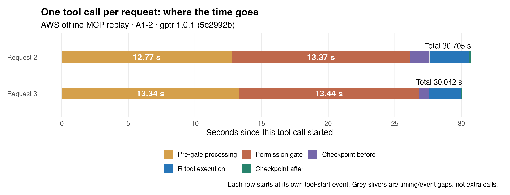
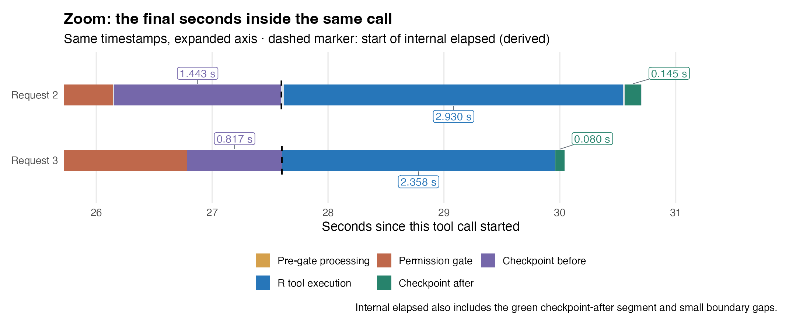
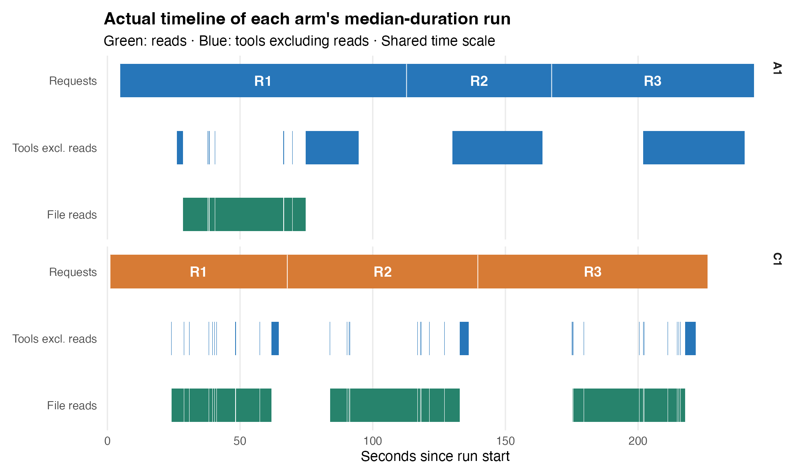

## A Is there really only one tool call per request?

**Yes. Both the original A1-2 trial and this replay make one `r` call in each of the three requests.**

| Request | Work inside that call | Original calls | Replay calls | Tool errors |
|---|---|---:|---:|---:|
| 1 | Read all 1,231 TSV files, inspect the inputs and write input-audit.csv | 1 | 1 | 0 |
| 2 | Reuse raw, summarize by file and write sample-summary.csv | 1 | 1 | 0 |
| 3 | Reuse raw, summarize by gene and write gene-summary.csv and research-report.md | 1 | 1 | 0 |

Counts come from `tool_execution_start` events. Each start has a successful end event.
Loops and multiple operations inside the code still belong to the same tool call.

**There were no retries or separate follow-up verification calls.** This finding applies only to A1-2.

## B Did the long calls recur in the replay?

**Yes. For requests 2 and 3, the outer interval exceeds the internal elapsed time by about 27.60 seconds.**

```chart bar horizontal unit=s
| Outer tool call | Internal elapsed
Request 1 | 56.731 | 53.993
Request 2 | 30.705 | 3.108
Request 3 | 30.042 | 2.440
```

The chart shows this AWS replay. The internal interval sits inside the outer interval; do not add them together.

| Request | Original: outer / internal (s) | Original gap (s) | Replay: outer / internal (s) | Replay gap (s) |
|---|---:|---:|---:|---:|
| 1 | 68.50 / 66.28 | 2.22 | 56.73 / 53.99 | 2.74 |
| 2 | 34.08 / 4.18 | 29.90 | 30.71 / 3.11 | **27.60** |
| 3 | 38.37 / 2.35 | 36.02 | 30.04 / 2.44 | **27.60** |

This is one replay, not a median across repeated trials. It reproduces the large gap, not the exact historical timings.

## C Where do the extra 28 seconds go?

**Most of the gap occurs before and inside the permission gate. The pre-execution checkpoint is not the main contributor.**

**Each row below is one complete function call, arranged in chronological order.**
Each row starts at its own tool-start event. The two requests did not run at the same time.



The long first part is neither model waiting nor a hidden second call.
Light-grey gaps preserve the measured boundaries; they are not folded into R execution.

**The next figure enlarges the end of the same calls.**
The axis still shows seconds since each call started, zoomed to about 26–31 seconds.



The dashed start is inferred as tool-end time minus internal elapsed time.
The internal interval includes blue, green and boundary gaps, not just the blue segment.

Colors: amber = pre-gate processing; brick red = permission gate; purple = checkpoint before; blue = R execution; green = checkpoint after.

| Non-overlapping outer phases | Request 2 (s) | Request 3 (s) | What was measured |
|---|---:|---:|---|
| Tool start → permission-gate entry | 12.773 | 13.339 | Includes argument checks, risk classification and the call hook; not timed separately |
| mcp_serve_gate | 13.373 | 13.445 | Direct measurement from gate entry to exit |
| checkpoint_before | 1.443 | 0.817 | Pre-execution object, file and state checks |
| Other boundary overhead | 0.008 | 0.001 | Residual differences between events and timing boundaries |
| **Subtotal: outer minus internal** | **27.597** | **27.602** | Excludes internal elapsed time |
| Internal elapsed | 3.108 | 2.440 | R tool execution, checkpoint after and internal boundary overhead |
| **Outer total** | **30.705** | **30.042** | Tool-start event to tool-end event |

These measurements revise the earlier hypothesis that checkpoints explain most of the gap.
They do not assign all pre-gate time to a particular risk-classification function.
Nor do they identify model thinking, repeated input reads or disk serialization as the cause.

A next step is to time risk classification and permission checks in more detail, including possible repeated scans of large in-memory objects.
This remains a hypothesis to test, not a root cause proved by this replay.

## D A laboratory work-order analogy: why all these steps?

Think of a tool call as a researcher handing a work order to a laboratory: receive it, review it, execute it, and return a record.
The complete dataset from the previous request is already on the bench, corresponding to A1's memory reuse.
This analogy explains the design roles; it does not claim to describe the authors' historical intentions.

### 1. Receive and interpret the work order: pre-gate processing

The system checks argument structure and the execution environment, then analyzes the code's possible effects.
It considers file writes, deletion, network operations and object overwrites, not just whether the code can run.
A call hook may inspect, reject or change the work order.

An assistant first marks which materials are needed, which records may change and which operations may be risky.
This supplies facts for the decision; it does not itself approve execution.

The full pre-gate interval took about 13 seconds. Its individual functions were not timed separately.
The source shows that risk analysis queries the type and size of assignment targets.
Requests 2 and 3 still contain a conditional branch that reads the inputs if `raw` does not exist.
Static analysis encounters this branch; that does not mean execution reads the data again.

**Optimization lead: reviewing a work order should not require repeatedly counting the whole warehouse.**
Whether object-size calculations dominate this interval requires direct timing.
Possible approaches include reusing object metadata within a call or computing only the information needed for a decision.
In-place object changes must invalidate cached metadata; the same object address alone does not prove unchanged contents.

### 2. Approve the work order: permission gate

Risk classification asks what the code may do. Permission checks ask whether current rules allow it.
The gate combines mode settings, explicit rules, sensitive operations and object-protection policies.
Automatic mode does not mean all permission checks disappear.

The assistant identifies risks, then a supervisor checks laboratory rules.
These are distinct, reasonable roles; they do not necessarily require two expensive analyses of the same work order.

**The source confirms a repeated classification path.** The MCP entry first calls risk classification.
Later, `perm_decide()` calls `call_risk()` to classify the tool input again.
The source comment explicitly describes recomputing risk from the raw input.

A call hook sits between the first analysis and the permission gate.
Checking that approval applies to the final input is therefore a reasonable design explanation.
This does not prove the hook changed this call, or that each classification took the full 13 seconds.

**Prioritize reuse with strict invalidation rules, rather than removing the permission gate.**
If code, environment and relevant rules are unchanged, reusing a trusted analysis result may be worth testing.
Changed inputs, environment or rules require renewed analysis.
Any implementation needs permission-behavior tests to establish that it remains safe.

### 3. Preserve the previous state: checkpoint_before

Before execution, the laboratory records the old state that might need restoration.
In gptr, separate checkpoint handlers cover objects, files and session state.
Object policies can retain references, copy objects or write recovery images; they do not always copy everything.
Behavior depends on object semantics, expected changes and budgets.

The purpose is recovery and undo, not an extra analysis cache for the next request.
This stage was not the main bottleneck in requests 2 and 3: it took 1.443 and 0.817 seconds.

Optimization could focus on state that will actually change and avoid needless snapshot work.
Disabling checkpoints changes recovery behavior; it is not automatically an equivalent optimization.
This replay kept checkpoints enabled and did not change the formal experiment's conditions.

### 4. Execute the work order: R tool execution

Only now does the code summarize the data already in memory and write the requested results.
Loops and output operations remain inside one tool call.
This stage took 2.930 seconds in request 2 and 2.358 seconds in request 3.

The blue segment measures the R tool handler, including evaluation and result processing.
It is not a line-level profile of pure arithmetic.
Optimizing the summary code alone cannot explain the preceding 28-second gap.

### 5. Record changes and return the record: checkpoint_after

After execution, the system compares states, organizes recovery information and completes the checkpoint record.
The laboratory records which materials and files changed, so recovery knows the boundaries of this operation.
This stage is inside internal elapsed time; its role differs from capturing the old state before execution.

It took only 0.145 and 0.080 seconds in requests 2 and 3, but 13.865 seconds in request 1.
Costs therefore depend on workspace state.
Fast later checkpoints do not show that all checkpoint work lacks optimization potential.

### Assessment: reasonable purposes, substantial costs to investigate

| Evidence level | What can currently be said |
|---|---|
| Measured | Pre-gate processing plus the gate takes about 26–27 seconds, or 85%–89% of each outer call in requests 2 and 3 |
| Confirmed in source | Both the MCP entry and permission decision contain risk-classification calls |
| Supported candidates | Reduce repeated analysis and repeated large-object metadata calculations, with strict invalidation rules |
| Not yet established | Each classification's time, the share spent computing object sizes, and the savings from any change |

The likely area for optimization is concentrated, but a reduction from 30 seconds to 3 seconds cannot yet be promised.
Next, time both classifications and object-size calculations separately.
Then test a controlled change against the same A1-2 tool inputs.

Source references are pinned to the replay commit:
[MCP entry and timing](https://github.com/Broccolito/gptr/blob/5e2992b13824fbf5218428d379a336dd44acddbb/R/mcp-server.R#L200),
[permission reclassification](https://github.com/Broccolito/gptr/blob/5e2992b13824fbf5218428d379a336dd44acddbb/R/agent-dispatch.R#L571),
[object metadata queries](https://github.com/Broccolito/gptr/blob/5e2992b13824fbf5218428d379a336dd44acddbb/R/perm-classify.R#L2297), and
[object checkpoint policy](https://github.com/Broccolito/gptr/blob/5e2992b13824fbf5218428d379a336dd44acddbb/R/ckpt-objects.R#L458).

## E Why does the original Gantt show just one long bar?

The figure below is from the **original formal experiment**, comparing A1-2 with C1-3.
It is not this replay's timeline. This report analyzes only A1-2.



A1 has one tool bar in each of requests 2 and 3.
**Its width represents the outer tool interval, not only R execution.**
Permission checks and state management sit inside the same bar without increasing the call count.

Read segments represent input I/O. Tool segments represent tool time after excluding reads.
Splitting a call into timing phases does not create additional calls.
The remaining model, network and harness time was not reproduced separately.

## F Which execution path did this replay use?

The replay used the complete original inputs and A1-2's three original tool-code blocks.
It used a gptr 1.0.1 development snapshot, **not an official release**:

`5e2992b13824fbf5218428d379a336dd44acddbb`

```flow
Outer tool start -> Argument checks and risk classification
Argument checks and risk classification -> Permission gate
Permission gate -> Checkpoint before
Checkpoint before -> Internal timer starts
Internal timer starts -> R tool execution
R tool execution -> Checkpoint after
Checkpoint after -> Tool end and internal elapsed recorded
```

**Internal elapsed includes the post-execution checkpoint; it is not pure R computation time.**

| Internal phase | Request 1 (s) | Request 2 (s) | Request 3 (s) |
|---|---:|---:|---:|
| mcp_serve_r | 40.125 | 2.930 | 2.358 |
| checkpoint_after | 13.865 | 0.145 | 0.080 |
| Other internal boundary overhead | 0.003 | 0.033 | 0.002 |
| **Internal elapsed** | **53.993** | **3.108** | **2.440** |

An offline provider drove the real `mcp_dispatch_local` tool-handling path.
All three requests shared one R environment, with default checkpoint settings.
The probes added timing without editing the external gptr source files.

| Replay method | Purpose | Used here? |
|---|---|---|
| recorded.R native document replay | Run the exported R code again | No |
| Original tool inputs → MCP tool-handling path | Inspect the outer/internal timing gap | **Yes** |
| Full original-model and Codex CLI rerun | Measure complete agent wall time again | No |

The offline provider makes no model requests and bypasses external CLI transport.
Its file-watcher lifecycle differs from the original CLI path.
These timings therefore cannot replace the original experiment's full wall time.

## G Where is the evidence?

The replay exited with code 0, with no errors in any of the three calls.
Only A1-2 was replayed; no other trial or C1 run was executed.

| File | Contents |
|---|---|
| [Microscopic phases](figures/micro-phases.csv) | Relative start, end and duration for the plotted phases |
| [ggplot source](figures/plot-micro.R) | Editable overview and end-of-call zoom |
| [phase-timing.csv](figures/phase-timing.csv) | Per-request phase timings |
| [timing.csv](figures/timing.csv) | Outer, internal and difference timings |
| [events.jsonl](evidence/events.jsonl) | Replay tool-start/end events and returned content |
| [profile.jsonl](evidence/profile.jsonl) | Raw function-entry/exit timestamps |
| [profile-mcp.R](evidence/profile-mcp.R) | Replay and timing code actually used |
| [calls.json](evidence/calls.json) | A1-2 original tool inputs |
| [Original experiment trace](../replay/A1-2/trace.jsonl) | Historical formal-experiment events |
| [Publication provenance](PROVENANCE.json) | Original local paths and source/copy hashes |

Original AWS record directory:

```text
/data/gptr-bench/biomedical/runs/t03-A1-2-mcp-profile-20261107
```

Original evidence archive SHA-256:

```text
99a42172bbbf8f1d8048526fc43fafe67875d881c6413da4523e52d8aefb811a
```

All replay chart values come from this recording, without pooling the original experiment or other replays.
This English edition retains the Chinese report's measurements and evidence limits; translation did not run a new experiment.
The timing probe preserves its original environment assumptions; it is evidence code, not a standalone portable installer.
For the separate portable synthetic reproducer, see [minimal replay](../minimal-replay/README.md).

GitHub displays this Markdown and its figures directly. Download or clone the repository and open [report.en.html](report.en.html) for the interactive view.
With ggplot2 installed, redraw the microscopic figures from this directory:

```bash
Rscript --vanilla figures/plot-micro.R figures
```
